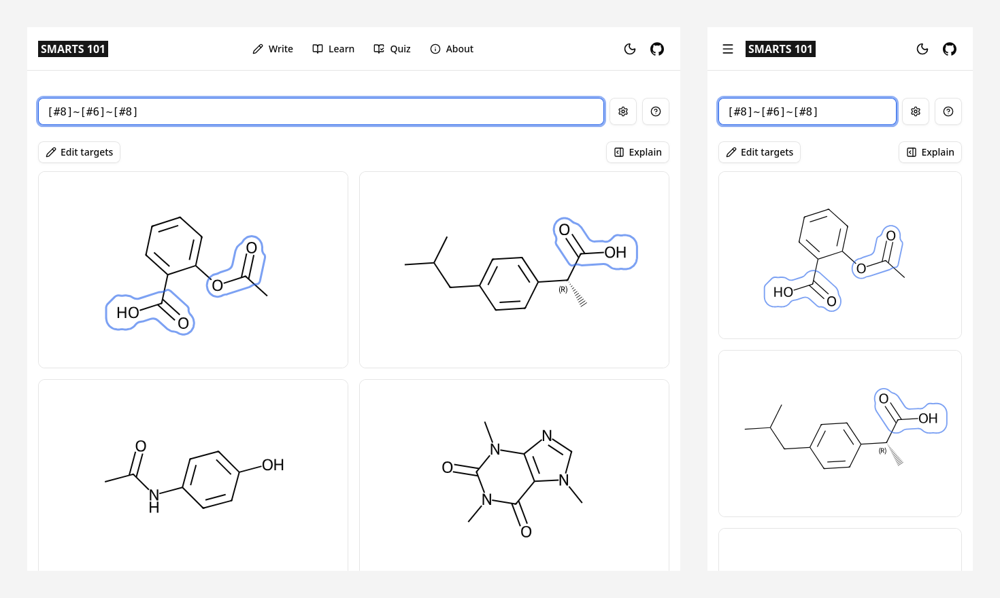

# SMARTS 101



Interactively build, test and debug SMARTS queries and reactions. Static-file web application with live results.
Like [regex101.com](https://regex101.com) but for SMARTS.

## Features

- **Queries** write SMARTS patterns and see highlighted matches across multiple molecules in real-time
- **Reactions** query reactions with separate reactant/product highlights and per-fragment
- **Syntax explanation** tree-sitter powered breakdown of atom, bond, and recursive expressions
- **Smarter SMARTS** find distinct molecules your pattern matches in the 100K smallest ChEMBL molecules, and use them as targets
- **Molecule examples** druglike compounds, amino acids, peptides, RNA/DNA bases, ChEMBL, macrocycles examples
- **Learn** a short SMARTS guide (`/how-to-smarts`) and a quiz (`/quiz`)
- and **self-hostable** (no backend, no data storage)

## Quick Start

Requirements: [Node.js](https://nodejs.org/) 24, [pnpm](https://pnpm.io/) and [Docker](https://www.docker.com/).

Docker is used to compile RDKit and the Smarter SMARTS WebAssembly module (with emscripten), and the first build takes a while.
The tree-sitter SMARTS grammar is compiled by the `tree-sitter-cli` dev dependency, which needs either emscripten or Docker.

```bash
git clone https://github.com/charnley/smarts101
cd smarts101
make                  # install dependencies and create .env
make dev PORT=5173    # builds the wasm modules if missing, then starts vite
```

Open `http://localhost:5173/` and start typing SMARTS.

## Deploy

Build the static site, then serve it with any web server

```bash
make build
# output in build/
```

Or build and run the Docker image (nginx), served on `http://localhost:8080/`

```bash
make build-docker
make start-docker
```

Pushing to `main` deploys to GitHub Pages (`.github/workflows/deploy.yml`).
Set `PUBLIC_UMAMI_WEBSITE_ID` (see `.env.example`) to enable optional Umami analytics, leave it empty otherwise.

## Development

```bash
make build-grammar-wasm          # rebuild the tree-sitter grammar after editing grammar.js
make build-smarter-smarts-wasm   # rebuild the Smarter SMARTS wasm (after make build-rdkit-image)
make test                        # grammar tests
npm run test:unit -- --run       # unit tests
npm run test:e2e                 # playwright tests
make format                      # prettier, CI checks this with make test-format
make start-storybook             # component stories
```

To regenerate the screenshot at the top of this file (needs [ImageMagick](https://imagemagick.org/) and playwright's firefox)

```bash
npx playwright install firefox
make readme-hero
```

## Technical Overview

| Package                                                                                                               | Purpose                                                       |
| --------------------------------------------------------------------------------------------------------------------- | ------------------------------------------------------------- |
| [rdkit](https://www.rdkit.org/)                                                                                       | RDKit WASM molecule rendering and SMARTS substructure search  |
| Smarter SMARTS                                                                                                        | Custom RDKit C++/WASM module for unique-environment matching  |
| [paper.js](https://paperjs.org/)                                                                                      | Vector graphics for highlight outlines                        |
| [tree-sitter](https://tree-sitter.github.io/)                                                                         | SMARTS grammar powers the syntax explain panel                |
| [codemirror](https://codemirror.net/)                                                                                 | Code editor with syntax highlighting and inline error markers |
| [sveltekit](https://svelte.dev/docs/kit) + [svelte](https://svelte.dev/)                                              | Web framework, compiles to a static website                   |
| [tailwindcss](https://tailwindcss.com/) + [shadcn-svelte](https://shadcn-svelte.com/) + [lucide](https://lucide.dev/) | UI Components                                                 |
| [vitest](https://vitest.dev/) + [playwright](https://playwright.dev/) + [storybook](https://storybook.js.org/)        | Tests and component development                               |
